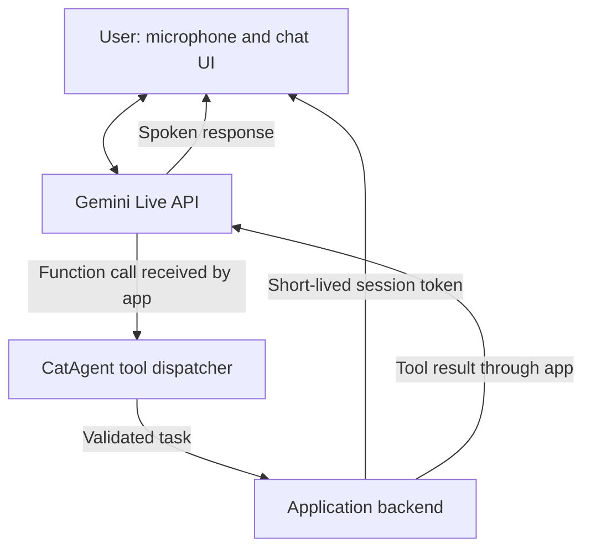

# Pawse 🐾

**A little cat. A helping hand.**

A voice-first AI cat companion that aims to help you get things done online. Pawse is the project name; **CatAgent** is the working concept behind its assistant.

[中文说明](README.zh-CN.md) · [Product spec](docs/SPEC.md) · [Hackathon notes](docs/HACKATHON.md) · [Contributing](CONTRIBUTING.md)

## Built for the hackathon

**Pawse is being built specifically for the Tech Europe AI Hackathon, sponsored by Google DeepMind.** Our goal is to turn a friendly cat interface into a useful assistant through Gemini-powered conversation, real-time voice, and tool calling.

This is an independent participant project. Event sponsorship does not imply endorsement of Pawse by Google or Google DeepMind.

## The idea

Tell your cat what you need. Let it call an appropriate tool. Hear what happened.

Instead of making users navigate another dashboard for every small task, we want Pawse to offer a conversational entry point to online assistance, with a visible record of its actions.

**Target demo — not implemented yet:**

> “Pawse, summarize this page in three points.”
>
> Pawse retrieves the page through an application tool, summarizes its contents, and speaks the result while showing the summary on screen.

## Current status

This repository currently contains the initial documentation and project setup only. There is no runnable application, deployed demo, or verified Gemini integration yet. Features below describe the intended hackathon MVP.

| Capability | Status |
| --- | --- |
| Project documentation and MIT license | Available |
| Cat companion interface | Planned |
| Real-time voice conversation with Gemini Live API | Planned |
| One useful online task through function calling | Planned |
| On-screen transcript and task result | Planned |
| Clear listening, working, and speaking states | Planned |

## How we plan to build it

- **Conversation:** Gemini Live API for streaming voice input and output.
- **Actions:** application-owned tools that execute a task and return a real result.
- **Authentication:** the backend holds the Gemini API key and issues ephemeral tokens for browser Live sessions.
- **Interface:** a cat companion with a transcript, task status, and visible results.

The frontend framework, backend runtime, model ID, and first task tool are still to be selected. Function calling proposes actions; our application must implement and execute the tools.

## Getting started

There is no installation or start command yet. For now:

1. Clone this repository.
2. Read the [MVP spec](docs/SPEC.md).
3. Obtain a Gemini API key through [Google AI Studio](https://aistudio.google.com/api-keys), using your assigned hackathon project if available.
4. Use `.env.example` as a reference for local configuration once the application is implemented. The future runtime must explicitly load those values.

Never put a permanent API key in browser code or commit it to Git. See [Security](SECURITY.md) and the [temporary account notes](docs/HACKATHON.md).

## MVP roadmap

- [ ] Choose the application stack and one concrete online task.
- [ ] Build the cat interface and microphone controls.
- [ ] Connect a real Gemini Live session.
- [ ] Implement one tool and send its result back to the model.
- [ ] Display a transcript and task result.
- [ ] Handle interruptions, permission errors, and connection failures.
- [ ] Record a short demo and document reproducible setup steps.

## Contributing

Small, focused contributions are welcome. Start with the [contribution guide](CONTRIBUTING.md) or open an issue describing a bug, feature, or hackathon task.

## References

- [Gemini Live API](https://ai.google.dev/gemini-api/docs/live-api)
- [Live API tool calling](https://ai.google.dev/gemini-api/docs/live-api/tools)
- [Ephemeral tokens](https://ai.google.dev/gemini-api/docs/live-api/ephemeral-tokens)
- [Hackathon account instructions](https://goo.gle/hackathon-account)

## License

[MIT](LICENSE) — Copyright © 2026 Pawse contributors. Third-party services, models, and assets remain subject to their respective terms and licenses.
