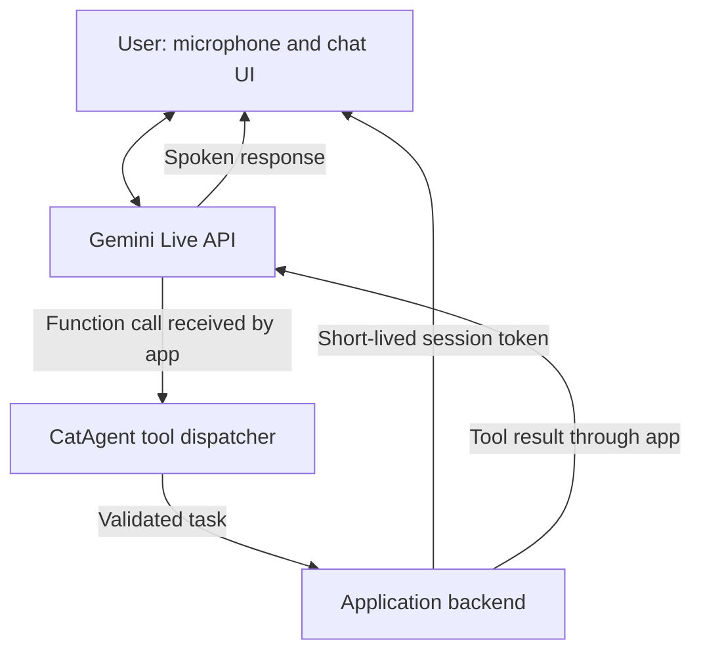

# Pawse 🐾

**A little cat. A helping hand.**

A voice-first AI cat companion that aims to help you get things done online. Pawse is the project name; **CatAgent** is the working concept behind its assistant.

[Product spec](docs/SPEC.md) · [Hackathon notes](docs/HACKATHON.md) · [Contributing](CONTRIBUTING.md)

## Built for the hackathon

**Pawse is being built specifically for the Tech Europe AI Hackathon, sponsored by Google DeepMind.** Our goal is to turn a friendly cat interface into a useful assistant through Gemini-powered conversation, real-time voice, and tool calling.

The repository includes a pre-existing CatAgent backend imported as a starting point. The voice interface and Gemini integration are the planned hackathon extension; the full backend was not created during the event.

This is an independent participant project. Event sponsorship does not imply endorsement of Pawse by Google or Google DeepMind.

## The idea

Tell your cat what you need. Let it call an appropriate tool. Hear what happened.

Instead of making users navigate another dashboard for every small task, we want Pawse to offer a conversational entry point to online assistance, with a visible record of its actions.

**Target demo — not implemented yet:**

> “Pawse, summarize this page in three points.”
>
> Pawse retrieves the page through an application tool, summarizes its contents, and speaks the result while showing the summary on screen.

## Current status

This repository contains project documentation and selected pre-existing Python backend source in [`backend/`](backend/README.md). The backend implements cat-care and IoT workflows using FastAPI and PocketFlow, with OpenAI/OpenRouter calls. It has not been verified end to end in this repository. There is no deployed demo or verified Gemini integration yet. The general online-task and voice experiences below remain planned.

| Capability | Status |
| --- | --- |
| Project documentation and MIT license | Available |
| Existing cat-care / IoT backend source | Imported; runtime not verified |
| Cat companion interface | Planned |
| Real-time voice conversation with Gemini Live API | Planned |
| One useful online task through function calling | Planned |
| On-screen transcript and task result | Planned |
| Clear listening, working, and speaking states | Planned |

## How we plan to build it

- **Conversation:** Gemini Live API for streaming voice input and output.
- **Actions:** application-owned tools that execute a task and return a real result.
- **Authentication:** the backend holds the Gemini API key and issues ephemeral tokens for browser Live sessions.
- **Interface:** a cat companion with a transcript, task status, and visible results.

The imported backend uses Python, FastAPI, and PocketFlow. The frontend framework, Gemini model, and first demo tool are still to be selected. Function calling proposes actions; our application must implement and execute the tools.

## Getting started

Start with the [backend setup outline](backend/README.md), [source import review](docs/IMPORT_REVIEW.md), and [Gemini migration guide](docs/GEMINI_INTEGRATION.md).

The imported backend has a `main.py` entry point, but its dependencies and service integrations have not been tested here. Knowledge collections, credentials, external services, and old deployment files are intentionally excluded. `backend/.env.example` documents the legacy settings; root `.env.example` describes the planned Gemini configuration.

Get a Gemini key from [Google AI Studio](https://aistudio.google.com/api-keys). Setting that key alone will not switch the current OpenAI/OpenRouter clients to Gemini; follow the migration guide.

Never put a permanent API key in browser code or commit it to Git. See [Security](SECURITY.md) and the [temporary account notes](docs/HACKATHON.md).

## MVP roadmap

- [x] Import selected existing backend source and document its provenance.
- [ ] Validate the backend dependencies and choose one concrete demo task.
- [ ] Build the cat interface and microphone controls.
- [ ] Connect a real Gemini Live session.
- [ ] Implement one tool and send its result back to the model.
- [ ] Display a transcript and task result.
- [ ] Handle interruptions, permission errors, and connection failures.
- [ ] Record a short demo and document reproducible setup steps.

## Contributing

Small, focused contributions are welcome. Start with the [contribution guide](CONTRIBUTING.md) or open an issue describing a bug, feature, or hackathon task.

## References

- [Gemini Live API](https://ai.google.dev/gemini-api/docs/live-api)
- [Live API tool calling](https://ai.google.dev/gemini-api/docs/live-api/tools)
- [Ephemeral tokens](https://ai.google.dev/gemini-api/docs/live-api/ephemeral-tokens)
- [Hackathon account instructions](https://goo.gle/hackathon-account)

## License

[MIT](LICENSE) — Copyright © 2026 Pawse contributors. Third-party services, models, and assets remain subject to their respective terms and licenses. See [third-party notices](THIRD_PARTY_NOTICES.md).
